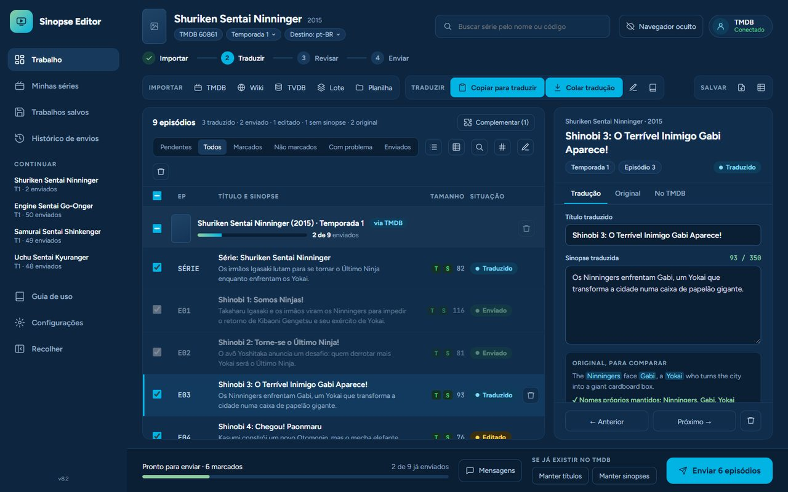
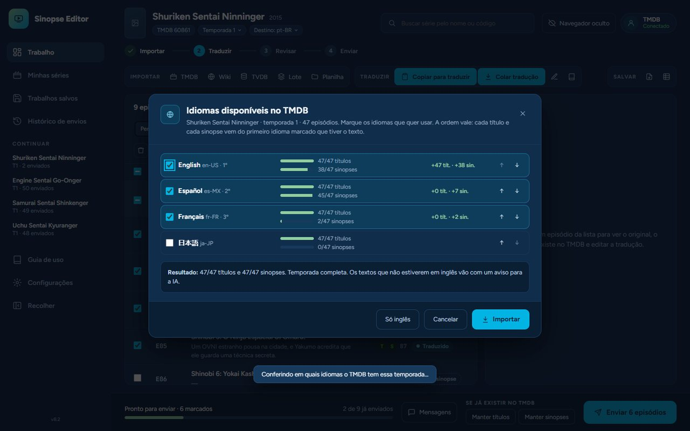

<div align="center">


# Sinopse Editor

**Traduza títulos e sinopses de séries para o português e envie ao TMDB, temporada por temporada.**

[](https://github.com/KalidoraBR/sinopse-editor/releases/latest)


<br>

<a href="https://github.com/KalidoraBR/sinopse-editor/releases/latest">
  
</a>

</div>

<br>

<table>
  <tr>
    <td width="50%"></td>
    <td width="50%"></td>
  </tr>
  <tr>
    <td align="center"><sub>Lista de episódios, revisão e painel de tradução</sub></td>
    <td align="center"><sub>Importação em vários idiomas</sub></td>
  </tr>
</table>

## O que é

O **Sinopse Editor** ajuda quem contribui com o [TMDB](https://www.themoviedb.org/) a deixar séries em português: ele busca os títulos e sinopses originais, prepara tudo para você traduzir com a IA de sua preferência (ChatGPT, Claude…) e envia o resultado para o TMDB, episódio por episódio, sem copiar e colar página por página.

Funciona com qualquer série: tokusatsu, anime, drama, animação.

## Recursos

<table>
  <tr>
    <td width="33%" valign="top"><b>Importação flexível</b><br><sub>TMDB (em vários idiomas), Wikis do Fandom, TVDB ou planilha. Várias séries e temporadas de uma vez pelo Lote.</sub></td>
    <td width="33%" valign="top"><b>Tradução guiada</b><br><sub>"Copiar para traduzir" leva um prompt pronto, com glossário da série e a regra de nunca traduzir nomes próprios.</sub></td>
    <td width="33%" valign="top"><b>Revisão antes de enviar</b><br><sub>Aponta títulos não traduzidos, sinopses longas e nomes que sumiram. Original e tradução lado a lado.</sub></td>
  </tr>
  <tr>
    <td valign="top"><b>Envio automático</b><br><sub>Preenche as páginas de edição do TMDB sozinho, com o navegador escondido, e mantém o que já existe se você preferir.</sub></td>
    <td valign="top"><b>Histórico e desfazer</b><br><sub>Guarda o texto antigo de cada campo trocado e permite voltar atrás.</sub></td>
    <td valign="top"><b>Página da série</b><br><sub>Traduz também o nome e a sinopse da série e das temporadas, criando a tradução que libera os episódios.</sub></td>
  </tr>
</table>

## Como instalar e usar

1. Baixe o arquivo **`Sinopse-Editor-vX.Y.zip`** em [Versões (Releases)](https://github.com/KalidoraBR/sinopse-editor/releases/latest).
2. Extraia a pasta em qualquer lugar (por exemplo, em Documentos) e abra **`Sinopse Editor.exe`**.
   > O Windows pode mostrar "O Windows protegeu o computador". Clique em **Mais informações → Executar assim mesmo**. Isso aparece porque o programa não tem assinatura digital paga.
3. Em **Configurações**, cole a sua chave gratuita da [API do TMDB](https://www.themoviedb.org/settings/api) (opcional, mas recomendada).
4. Clique na sua conta (canto superior direito) e entre no TMDB. O login fica salvo **só no seu computador**.
5. Escolha a série, importe a temporada, **Copiar para traduzir** → traduza na IA → **Colar tradução** → **Enviar**.

**Requisitos:** Windows 10 ou 11 e Google Chrome instalado.

<details>
<summary>Rodar a partir do código-fonte</summary>

```bash
pip install -r requirements.txt
python sentai_studio.py
```

Para gerar a versão portátil (pasta `dist/Sinopse Editor`), rode `gerar_portatil.bat`.

</details>

## Seus dados ficam com você

A chave da API, o login do TMDB, o histórico e os trabalhos ficam **apenas na pasta do programa, no seu computador**. Nada disso faz parte deste repositório nem é enviado a lugar nenhum além do próprio TMDB.

## Feito com

Python · [pywebview](https://pywebview.flowrl.com/) · [Playwright](https://playwright.dev/python/) · API do TMDB · API do MediaWiki (Fandom)

---

<div align="center">
<sub>Este produto usa a API do TMDB, mas não é endossado nem certificado pelo TMDB.</sub>
</div>
